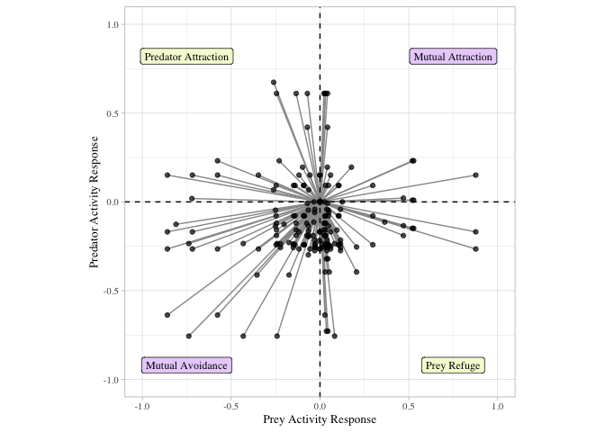
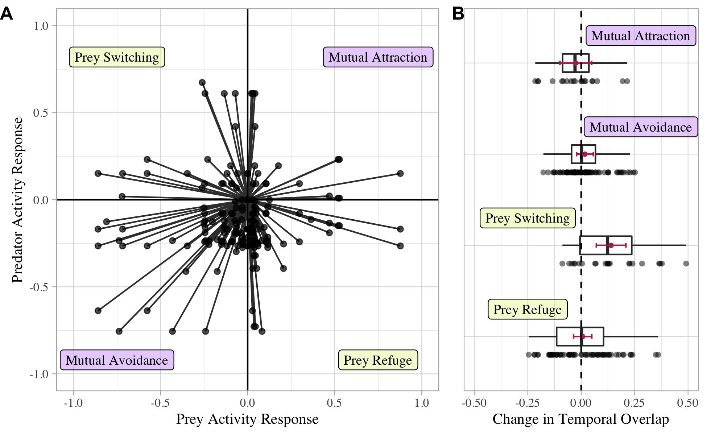

VanScoyoc et al. - Figure 2
================

<!-- -->

<!-- -->

**Fig. 2.** *Human influence on predator-prey temporal activity and
overlap based on review of camera trap studies between paired settings
of low and high human use. (a) Humans altered diel activity in mammal
predator-prey dyads via four major pathways: mutual attraction, mutual
avoidance, prey refuge, and prey switching. Lines reflect the relative
magnitude and direction of diel activity response toward nocturnality
(-1) or diurnality (1) for each predator-prey dyad at paired settings of
low and high human use (n = 178 predator-prey dyads, 19 studies). (b)
Change in predator-prey temporal overlap between settings of low and
high human use did not vary predictably with predator-prey activity
responses (n = 167 predator-prey dyads, 16 studies). Similar
predator-prey responses (i.e., prey refuge, prey switching) to humans
did not result in increased overlap between dyads, likewise opposite
predator-prey responses (i.e., mutual attraction, mutual avoidance) to
humans did not result in decreased overlap between dyads as predicted.
Black dots represent change in temporal overlap for each dyad. Red error
bars represent estimated marginal means and ± 95% confidence interval.*
