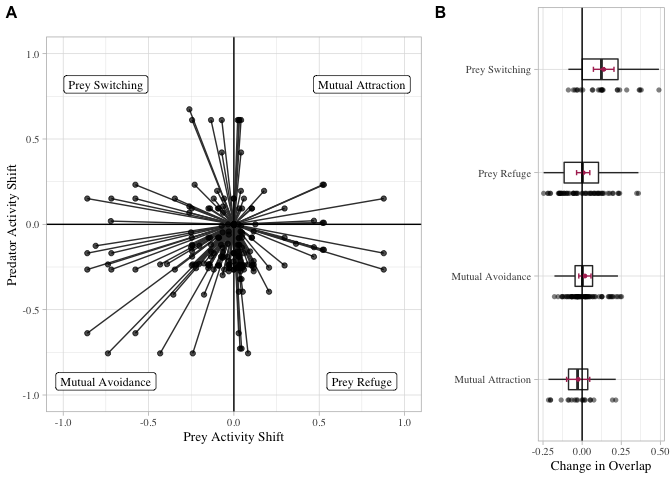

VanScoyoc\_et\_al\_plotting\_results
================

<!-- -->

**Fig. 2.** *An analysis of human influence on predator-prey overlap.
(a) Humans altered activity in mammal predator-prey dyads via four major
pathways. Lines represent the relative magnitude and direction of diel
activity shifts for each predator-prey dyad between paired sites of low
and high human activity (n = 184 predator-prey dyads, 19 studies). (b)
Predator-prey activity shifts did not alter temporal overlap between
predator-prey dyads (n = 177 predator-prey dyads, 17 studies). Black
dots represent change in temporal overlap for each dyad. Red error bars
represent estimated marginal means and ± 95% confidence interval.*
