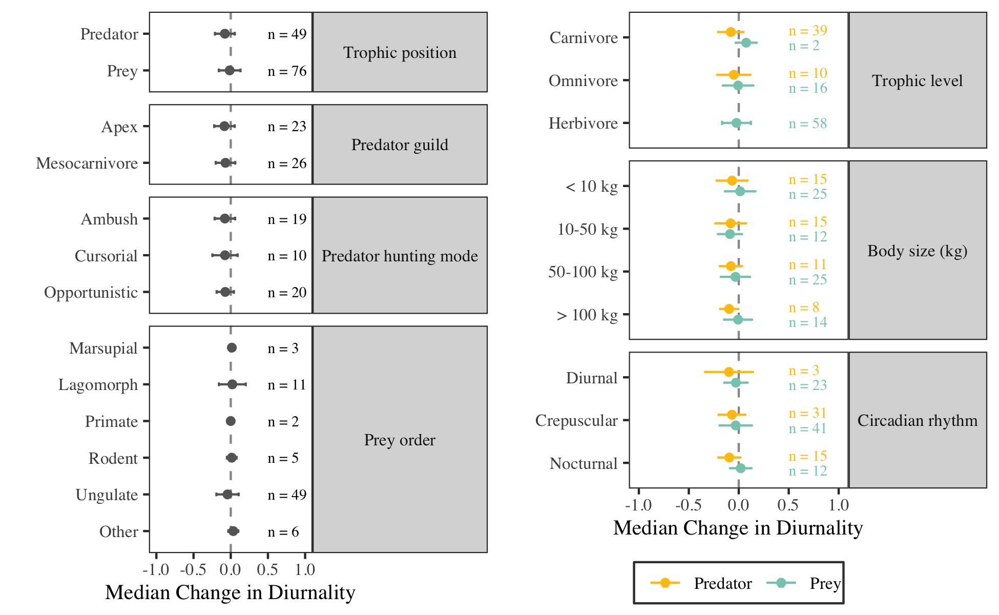

Van Scoyoc et al. - Supplementary Figure S1
================

<!-- -->
**Fig. S1.** *The influence of functional traits on the difference in
percent diurnal activity for terrestrial mammal predators and prey
between sites of high and low human use (n = 49 predators, n = 76 prey,
19 studies).*
